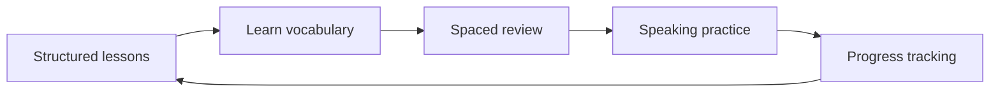

# Saegim

**Personal Project · Korean Language Learning**

Saegim is a free, mobile-first Korean-learning app built around structured lessons, vocabulary review, speaking practice, and long-term progress. The project grew from my earlier [KoreanDaily](https://github.com/212Aeds/KoreanDaily) prototype into a larger full-stack application designed to make studying Korean more organized and consistent.

The current beginner path includes 57+ lessons, a 5,000+ entry Korean-English dictionary, three-step spaced vocabulary review, and a 100-card speaking deck. Learners can study as a guest or use a signed-in account for persistent progress.

## The learning flow

1. Follow the structured beginner curriculum and work through Korean lessons.
2. Learn vocabulary connected to lesson content instead of relying only on isolated word lists.
3. Review previously learned words through a three-step spaced review system.
4. Practice speaking with Korean prompts and device-based Korean text-to-speech.
5. Use an account to keep learning progress available across study sessions.

The goal is to connect lessons, vocabulary, review, and speaking practice into one learning path rather than treating them as separate tools.

## How the parts work together



Lesson content introduces Korean concepts and vocabulary, the review system brings material back after studying, and speaking cards provide another way to practice familiar Korean. Account progress connects these parts so learners can continue where they left off.

## What works today

- Follow a beginner Korean curriculum with 57+ lessons.
- Study curated vocabulary connected to lesson content.
- Search a 5,000+ entry Korean-English reference dictionary.
- Review vocabulary through a three-step spaced review system.
- Practice with a 100-card Korean speaking deck.
- Listen using Korean voices available through the learner's device.
- Adjust speaking voice and pace.
- Study as a guest or create an account for persistent learning progress.
- Export or delete account data.

Saegim is still an active personal project. The dictionary is intended as a broad reference bank and has not been individually reviewed by a Korean-fluent editor. Speaking quality also depends on the voices provided by the user's browser and operating system.

There is currently no AI conversation, pronunciation scoring, social system, or subscription.

## Tech stack

Next.js, TypeScript, NestJS, PostgreSQL, Neon, and Docker.

The project is organized as a monorepo with separate web and API applications.

## Run locally

Requires Node.js 20.9 or newer.

1. Install dependencies with `npm install`.
2. Copy `.env.example` to `.env` and configure `DATABASE_URL` and `WEB_ORIGINS`.
3. Copy `apps/web/.env.example` to `apps/web/.env.local` and configure the frontend API URL.
4. Start the included local PostgreSQL database with `npm run db:up`.
5. Apply the SQL migrations in `apps/api/db/` in numeric order when needed.
6. Seed the dictionary with `npm run db:seed:words`.
7. Start the project with `npm run dev`.

Build both applications with:

```bash
npm run build
```

Start production processes with `npm run start:web` and `npm run start:api` after configuring production environment variables.

## Repository map

- `apps/web/` — Next.js learning interface
- `apps/web/app/curriculum.ts` — core lesson curriculum
- `apps/web/app/more-lessons.ts` — additional lesson content
- `apps/web/app/progress.ts` — learner progress logic
- `apps/web/app/speak-cards.ts` — speaking practice content
- `apps/web/app/word-bank.ts` — vocabulary used by the learning experience
- `apps/api/` — NestJS backend and account API
- `apps/api/db/` — PostgreSQL migrations and dictionary data

## Dictionary source

The 5,000+ entry Korean-English dictionary is adapted from [cc-kedict](https://github.com/mhagiwara/cc-kedict) under CC BY-SA 3.0. Attribution and reuse information is available in `apps/api/db/seeds/ATTRIBUTION.md`.

Lesson vocabulary is curated separately from the larger reference dictionary.
